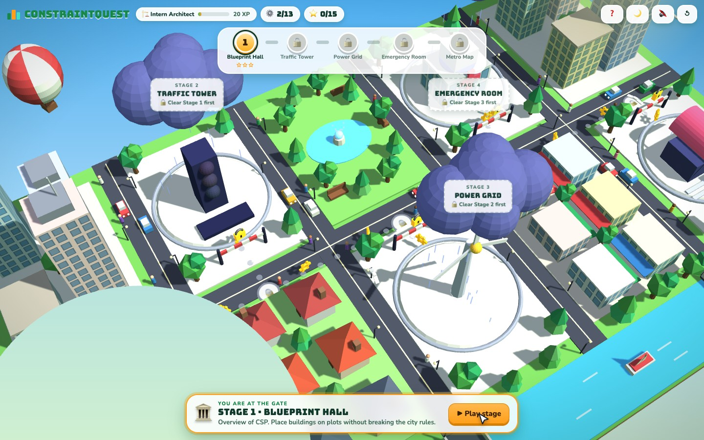
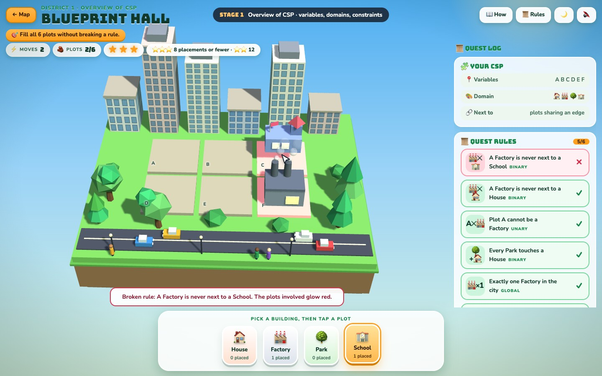
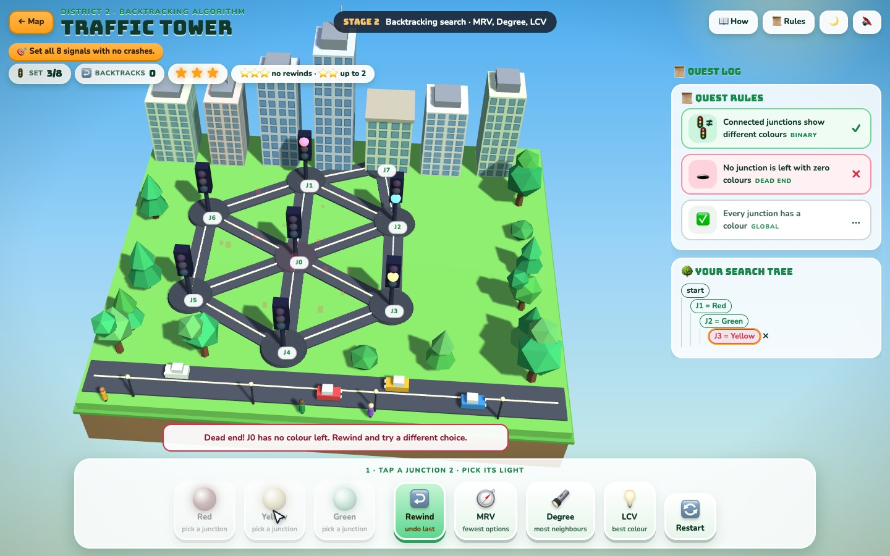
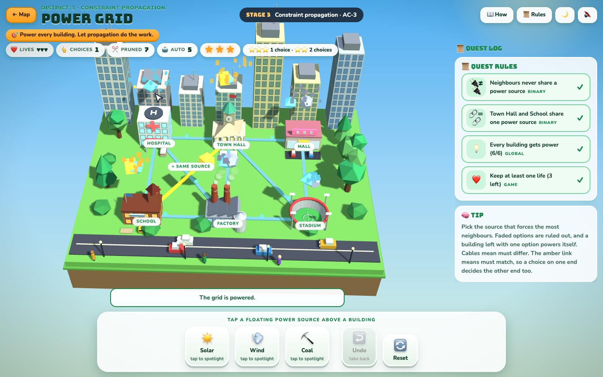
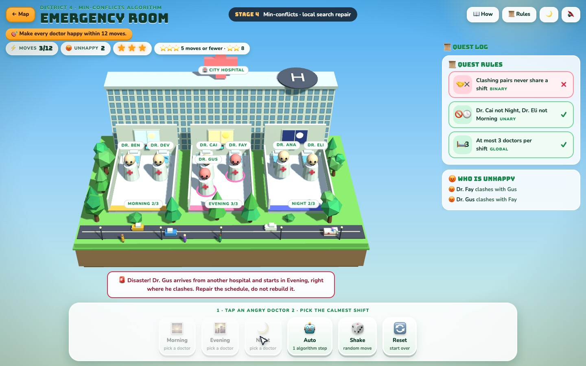
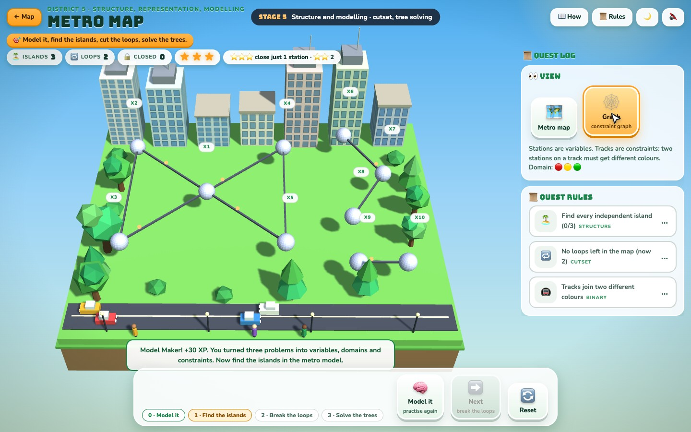
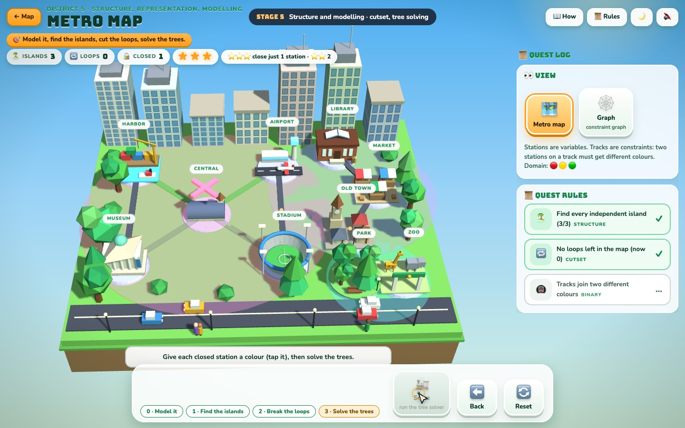

# ConstraintQuest

**A 3D city-restoration game that teaches Constraint Satisfaction Problems (CSPs) by letting you play them.**

> **About this project.** ConstraintQuest was made as a **class game for presenting one topic: Constraint Satisfaction Problems (CSP)** in an Artificial Intelligence course. Instead of slides, the class plays through five districts of a storm-hit city, and every district is a CSP solved with a different technique from the syllabus.



You are **Archie, the City Architect**. A storm has damaged the city, and you walk across a 3D map to five districts. Each district hides a puzzle. Clearing a stage lifts the storm, unlocks the next barrier and sends Archie to the next district.

## Syllabus topics covered

| Part | Syllabus topic | Stage | What you do |
|---|---|---|---|
| **1** | Constraint Satisfaction Problem: overview | **1 · Blueprint Hall** | Fill 6 plots with buildings without breaking any rule |
| **1** | Backtracking Search for CSP | **2 · Traffic Tower** | Colour 8 junctions, hit dead ends, press **Rewind** |
| **2** | Local Search for CSP: **Constraint Propagation** | **3 · Power Grid** | Pick one power source and watch options vanish from neighbours (AC-3) |
| **2** | Local Search for CSP: **Min-Conflicts Algorithm** | **4 · Emergency Room** | Repair a clashing hospital schedule one doctor at a time |
| **3** | Structure of CSP: **Representation and Modelling** | **5 · Metro Map** | Model problems, find islands, break loops, solve the trees |

Every stage is the same idea in a new costume: **variables** (what you decide), **domains** (what each can be) and **constraints** (the rules).

## Screenshots

| | |
|---|---|
|  |  |
| **Stage 1.** A School placed next to the Factory turns a rule card red. | **Stage 2.** A dead end: the hub junction has no colour left. The search tree on the right shows the failed try. |
|  |  |
| **Stage 3.** One tap and propagation powers the whole grid. | **Stage 4.** A surprise doctor arrives mid-repair; the schedule is repaired, not rebuilt. |
|  |  |
| **Stage 5.** The metro as a constraint graph with 3 islands and 2 loops. | **Stage 5.** Closing Central (red cross) breaks every loop, so only trees remain. |

## Demo video

A 4-minute screen recording of the game's demo mode playing through all five stages:
[`docs/video/ConstraintQuest_demo.mp4`](docs/video/ConstraintQuest_demo.mp4) (1080p, 43 MB). Open the file on GitHub to play it in the browser.

## How to run it

ConstraintQuest is **one self-contained HTML file**. There is nothing to install.

1. Download or clone this repository.
2. Open `constraintquest.html` in a recent desktop browser (Chrome, Edge, Safari or Firefox).

The page loads [Three.js r128](https://cdnjs.cloudflare.com/ajax/libs/three.js/r128/three.min.js) and two Google Fonts (Bungee, Nunito) from the internet, and needs **WebGL**.

If your browser is strict about local files, serve the folder instead:

```bash
python3 -m http.server 8765
# then open http://localhost:8765/constraintquest.html
```

## How to play

- **Move Archie:** click or tap the map, or use `W A S D` / the arrow keys.
- **Enter a stage:** walk onto a glowing plaza and press **▶ Play stage** (or `Enter` / `Space`). A striped barrier with a padlock means the stage is still locked.
- **Collect gears** on the roads for bonus XP (13 in total).
- **Win a stage** to earn up to **3 stars**, XP, a badge and a bonus quiz question (+25 XP). Press **Continue** and Archie walks to the next district.
- **Ranks** go from Intern Architect up to Chief Architect. There are 15 stars in total.

### The five puzzles

| Stage | Rules | 3 stars |
|---|---|---|
| **1 · Blueprint Hall** | 6 plots (A to F) and 4 building types. A Factory is never next to a School or a House. One plot cannot hold a particular building (this changes from board to board). Every Park touches a House. Exactly one Factory and at least one School. | 8 placements or fewer |
| **2 · Traffic Tower** | Colour 8 junctions Red, Yellow or Green so connected junctions differ. A crash means you broke a rule; a dead end means a junction has no colour left. **Rewind** undoes a choice. **MRV**, **Degree** and **LCV** hint buttons show the heuristics. | No rewinds |
| **3 · Power Grid** | Give each of 6 buildings Solar, Wind or Coal from its allowed list. A cable means “must differ”, the amber link means “must match”. Each tap runs **AC-3** propagation. A wipe-out costs a life (3 lives). | 1 choice |
| **4 · Emergency Room** | Make every doctor happy in 12 moves. Clashing pairs cannot share a shift, some doctors cannot work some shifts, and a shift holds at most 3. Tap an angry doctor and move them to the shift with the fewest clashes (the crowned card). **Auto** performs one real min-conflicts step; **Shake** escapes plateaus. A surprise doctor arrives after move 3. | 5 moves or fewer |
| **5 · Metro Map** | Step 0 **Model it** (variables, domains, constraints for 3 problems), then find the **islands**, close stations to break the **loops** (a cutset), colour the closed stations and press **Solve** to solve the trees in one pass. | Close just 1 station |

Every stage has several boards (24 in total), so **Play again (new board)** gives a fresh puzzle.

## Demo mode for presenting

The game can **play itself** from start to finish, which makes it easy to screen-record a presentation or to show the whole game in a few minutes.

- Press **Shift + P** to start (a 3-second countdown first). Press **Esc** to stop.
- Or open the page with `?demo` to start automatically.
- It runs all five stages in about four minutes, using fixed boards so every run looks the same.

| Option | Example | Effect |
|---|---|---|
| `speed` | `?demo&speed=1.2` | Plays faster or slower (0.5 to 2) |
| `sound` | `?demo&sound=0` | Starts muted |
| `topics` | `?demo&topics=0` | Hides the on-screen CSP topic label |

Demo mode never changes your saved progress.

## Where the algorithms are in the code

Everything lives in `constraintquest.html`. The puzzle logic sits in a block between `/* LOGIC START */` and `/* LOGIC END */`.

| Topic | Functions |
|---|---|
| CSP overview (Stage 1) | `d1Check`: unary, binary and global constraints |
| Backtracking (Stage 2) | `assign` and `rewind` inside `mountD2`, `d2Legal`, `hintMRV`, `hintDeg`, `hintLCV`, and `d2Bench` (random order against the heuristics) |
| Constraint propagation (Stage 3) | `d3Propagate`: AC-3 over “differ” and “match” arcs |
| Min-conflicts (Stage 4) | `d4Conf`, `d4Unhappy`, and `autoStep` inside `mountD4` |
| Structure, representation, modelling (Stage 5) | `d5Info` (islands, loops), `d5Solve` (tree solver), and the `MW` modelling workshop |

## Project report

A full write-up with screenshots, code excerpts and measured results for every topic is in
[`docs/ConstraintQuest_CSP_Report.pdf`](docs/ConstraintQuest_CSP_Report.pdf) (18 pages).

Some results from the report:

- Stage 1: 12 of the 4,096 possible assignments solve the board.
- Stage 2: about 33 backtracks with random variable order against 0 with MRV + Degree + LCV.
- Stage 3: 6 of the 13 possible first taps power the whole grid; plain backtracking needed 10 backtracks on the same board.
- Stage 4: min-conflicts solves about 86% of simulated runs within the 12-move limit, against about 36% for random moves.
- Stage 5: 3 islands and 2 loops; closing one station (Central) leaves only trees, solved with no backtracking.

All 24 puzzle boards were checked by brute force and are solvable, and the three-star targets are reachable on every board.

## Tech notes

- Plain HTML, CSS and JavaScript in a single file, with [Three.js](https://threejs.org/) r128 for the flat-shaded 3D scenes.
- Progress (stars, XP, gears, quiz bonuses) is saved in the browser's `localStorage`.
- Fonts: Bungee and Nunito from Google Fonts.

## Limitations

- Built for a **laptop presentation**: there is no phone layout and the 3D scene is not usable with a screen reader.
- It needs an internet connection (for the 3D library and fonts) and WebGL.
- Progress is stored per browser. There is no leaderboard or shared score, because it was made for presenting in class.

## License

Released under the [MIT License](LICENSE). You are free to use, copy, modify and share it, as long as the license notice is kept.
